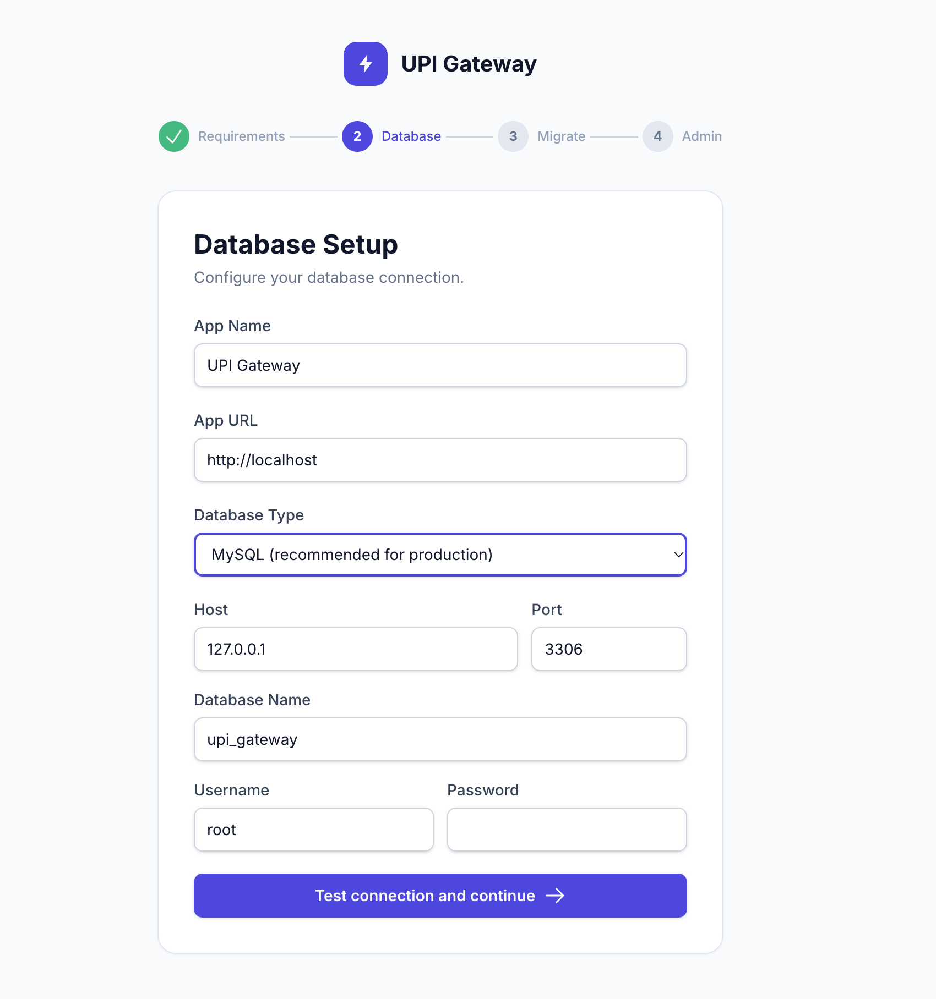
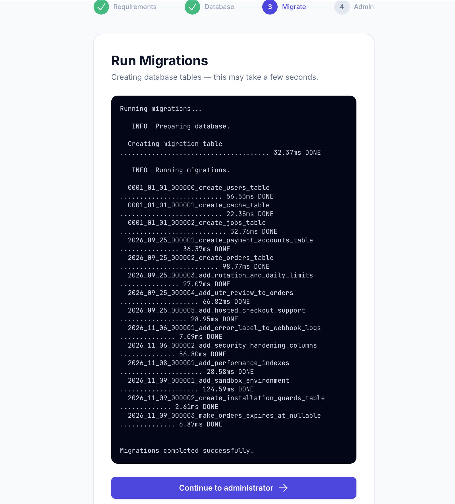
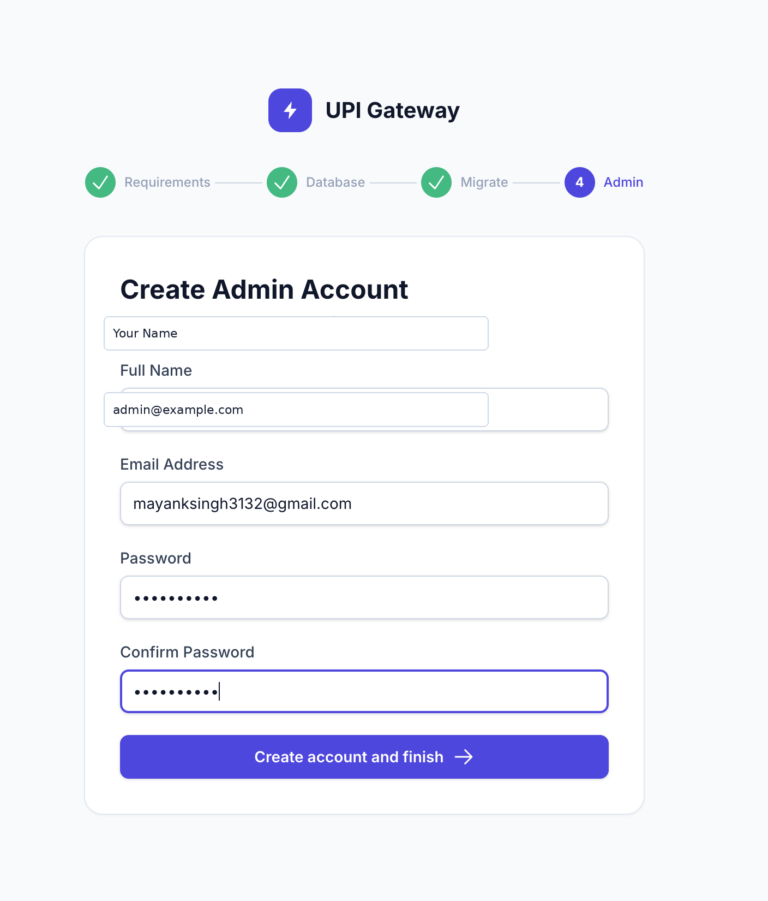

# Web Installation Wizard

Every supported deployment method ends in this browser flow. cPanel and Ubuntu VPS instructions prepare PHP, MySQL, filesystem permissions, and the web server; the wizard then performs application setup.

The wizard writes `ALLOW_REGISTRATION=false` to `.env`; public `/register` GET and POST requests return 404 and the login page hides the signup link. An administrator may intentionally open public merchant signup by setting `ALLOW_REGISTRATION=true` in the server's private `.env` file and refreshing cached Laravel configuration with `php artisan config:cache` if applicable. Existing merchant accounts and administrator controls remain available with signup disabled.

## Before opening `/install`

The Installation Wizard is completely passwordless, secure, and beginner-friendly without requiring manual tokens, setup passwords, or HTTP Basic Authentication. On first access, the wizard inspects requirements and allows you to proceed directly to database setup. For security, database hosts must be local (`127.0.0.1` or `localhost`), ensuring external visitors cannot hijack uninstalled applications. An existing installation stays locked during a database outage; an incomplete first-time installation can safely resume.

Verify PHP 8.2+ and required extensions: PDO, PDO MySQL, OpenSSL, mbstring, tokenizer, JSON, cURL, fileinfo, XML, and BCMath. Ensure PHP Session Support is enabled, and pre-compiled production assets (`public/build/manifest.json`) are present. Create an empty MySQL 8.x or MariaDB 10.x/11.x database and a user able to create and alter tables. The prepared package must contain `vendor/autoload.php` and `public/build/`. Pre-built production packages are available directly via **GitHub Code → Download ZIP** (`main.zip`), from [GitHub Releases (`latest-main`)](https://github.com/mynkdev-21/upi-gateway/releases/tag/latest-main), or as GitHub Actions artifacts (see [CPANEL.md](CPANEL.md#obtaining-the-production-package)).

### Universal Deployment Topologies

UPI Gateway natively supports three deployment patterns:

1. **Main domain:** `https://example.com/` (Document Root set to `public/`).
2. **Subdomain:** `https://pay.example.com/` (Document Root set to `public/`).
3. **Subdirectory:** `https://example.com/payment/` or `https://amtechinfo.online/repotest/` (nested within an existing site).

The installation wizard includes intelligent URL detection that accurately identifies:
- The active scheme (`https://` via direct TLS, Cloudflare reverse proxy headers `HTTP_CF_VISITOR`, or trusted upstream proxies `X-Forwarded-Proto`).
- The public host name and port.
- Any subdirectory path prefix (e.g. `/repotest` or `/payment`).

The installer performs browser checks of clean routing, actual production assets and private-file protection. Nginx requires a public-only server mount; the wizard generates it using the detected prefix and physical public path, plus the PHP-FPM address supplied from the active panel handler. It does not apply server configuration automatically. See [deployment modes and panel instructions](DEPLOYMENT.md).

The document root or URL mount must expose only Laravel's `public/` directory. `storage/` and `bootstrap/cache/` must be writable by PHP, and the application must be able to create `.env`. Use HTTPS in production. SQLite is not supported at runtime.

## Step-by-step wizard

1. Open `https://yourdomain.com/install` (or `https://yourdomain.com/subdirectory/install`).
2. On **Server Requirements**, confirm green checks for PHP 8.2+, 9 required extensions, Session Support, Writable Paths, and Production Assets (`public/build/`). If running in a subdirectory on Nginx, review the diagnostic recommendations. Fix any missing extensions or permissions and refresh.
3. On **Database Setup**, verify the prefilled App Name and auto-detected HTTPS App URL (including any subdirectory path). MySQL is the only database type. Enter host, port (`3306` unless your host says otherwise), full database name, full username, and password, then select **Test connection and continue**.
4. After connection success, the wizard writes `.env` atomically, generates `APP_KEY` when needed, applies production-safe settings, and continues.
5. On **Run Migrations**, start migration to create the required tables. Failures show a generic message; fix database permissions/settings and retry.
6. On **Create Admin Account**, enter Full Name, Email Address, Password, and Confirm Password. The password must be at least 10 characters.
7. On **Installation Complete**, choose **Go to Login**. The installation marker locks the wizard. The API is unavailable before installation and the wizard cannot be reopened after success.

## Screenshots

The following screenshots show the actual Installation Wizard flow:

### Database setup



### Successful migrations



### Create administrator



## After installation

Configure merchant accounts, payment accounts, webhooks, queue processing, scheduled expiry processing, HTTPS, restricted permissions, and MySQL backups. See [CPANEL.md](CPANEL.md) or [VPS.md](VPS.md).

## Payment verification note

For manual UPI accounts, a customer-submitted UTR places the order in **Review**. A matching UTR entered by a merchant is not proof of payment and does not mark a Live order as paid. Live payment completion requires trusted provider verification. A separately protected administrator override, when used, requires an exact amount confirmation, an independent verification reference, a written reason, and an append-only audit record.

## Payment accounts and compliance

- **Commercial UPI collections:** For business payment collections, merchants are strongly advised to configure registered merchant or current-account VPAs, or utilize official Payment Gateway integrations (PhonePe PG, Paytm PG). Personal savings-account UPI handles are intended for personal (P2P) transfers; utilizing personal accounts for commercial sales may violate bank terms of service, trigger automated velocity blocks, or result in account restrictions by the receiving bank.
- **Account verification:** UPI Gateway routes payments and generates deep links based on merchant-supplied configuration. It does not independently verify VPA ownership, bank KYC, or legal account classification (Savings vs. Current). Merchants are solely responsible for ensuring their accounts comply with their banking partners' terms.
- **Account rotation and limits:** Account rotation distributes incoming orders across multiple active accounts for operational load balancing, high availability, and provider redundancy. Rotation must not be used to evade bank velocity limits, split commercial turnover to bypass regulatory thresholds, or circumvent financial institution restrictions.
- **Explicit account selection:** If an API request explicitly provides `payment_account_id`, that exact account is validated (must be active, Live-compatible, and within its daily limit). If the requested account is disabled, unavailable, or over its limit, the request is rejected with a validation error; it is never silently routed to another account.

## Paytm Provider Architecture & Feature Flag

The gateway supports two distinct Paytm integrations:

1. **Official Paytm PG (`paytm_pg`)**: Uses official, production-grade endpoints with signed checkout sessions and SHA-256 HMAC response verification via `PaytmChecksum`. This is the recommended provider for all production commercial payment processing.
2. **Unofficial Paytm for Business (`paytm_business`)**: Uses an unauthenticated status-polling endpoint (`https://securegw.paytm.in/merchant-status/getTxnStatus`). It does not provide cryptographic signatures, and Paytm offers no developer SLA.

### Feature Flag (`GATEWAY_ENABLE_PAYTM_BUSINESS`)

To control the unofficial Paytm for Business integration, configure `.env`:

```dotenv
GATEWAY_ENABLE_PAYTM_BUSINESS=true
```

- **Default:** `true` (preserves backward compatibility for existing deployments).
- **Safe Disabling (`false`):**
  - Rejects new Paytm Business account creation via the dashboard and API.
  - Rejects order creation targeting Paytm Business accounts.
  - Verification polling for existing pending orders safely returns a `disabled` pending result and will never mark orders `PAID`.
  - Existing account records, encrypted credentials, historical orders, and audit logs remain strictly preserved.
  - Accounts are never silently switched to other providers.
  - Official Paytm PG (`paytm_pg`) and PhonePe PG (`phonepe_pg`) are completely isolated and unaffected.

## Payments received after expiry

All new order notifications use the [transactional webhook outbox](WEBHOOK-OUTBOX.md). Run migrations before starting the updated application, and keep both scheduler and queue worker running. Late `order.paid` and earlier `order.expired` events retain separate immutable snapshots and stable IDs; consumers must deduplicate by event ID and handle out-of-order delivery using the per-order sequence.

A saved UPI QR or intent can remain payable after its gateway order expires. Live orders using Paytm Business, Paytm PG, or PhonePe PG status verification can be recovered automatically for **24 hours after `expires_at`**. An expired order becomes paid only after the server checks the provider's status API and validates the order, amount, INR currency, reference, provider account, and Live environment. A pending, failed, invalid, or mismatched response leaves it expired. Frontend callbacks and submitted UTRs cannot authorize recovery. Internal Sandbox simulations and manual UPI accounts are excluded.

Configure the window and scheduler workload in `.env`:

```dotenv
GATEWAY_LATE_PAYMENT_GRACE_HOURS=24
GATEWAY_LATE_PAYMENT_CHECK_INTERVAL_SECONDS=300
GATEWAY_LATE_PAYMENT_BATCH_SIZE=100
```

Setting the grace period to `0` disables automatic late recovery. Expired orders are checked at most once per interval (minimum 120 seconds), including browser/API polling and forced provider returns. Each `orders:check-pending` scheduler run processes at most the configured number of due expired orders (1–1000), oldest checked first. Keep the scheduler and webhook queue worker running as described in [CPANEL.md](CPANEL.md) or [VPS.md](VPS.md). After changing configuration, rebuild any deployed configuration cache with `php artisan config:cache`.

Provider checks use a 120-second per-order cache lock, released on completion and automatically expiring after a crashed process. Use the existing shared `database` cache store, including the `cache_locks` table, on all application instances. Do not switch production to a process-local array/null store. No SQL row locks are held by the check service during provider HTTP; the final payment transaction locks and revalidates the order and payment account. Provider request timeouts are unchanged.

Recovery depends on the provider retaining a queryable status. Paytm Business uses the application's existing unofficial status endpoint, whose availability is not guaranteed. The grace period is a verification window, not a promise that a transfer will be detected or settled. Keep your merchant integration able to accept an authenticated `order.paid` webhook after an earlier `order.expired` event, and fulfill each order only once.

**After the configured deadline, no automatic provider checks or recovery are performed.** The order remains expired even if the bank later receives money. Do not ask the customer to pay again without checking. Investigate with the bank/provider and use the separately authorized, audited administrator review process or arrange a refund through the appropriate provider/bank. Do not treat the customer's UTR alone as proof. No automatic refund is initiated.

Late checks log order/account IDs, environments, provider, expiry, and a safe outcome or validation-field list. Provider payloads, credentials, UTRs, and secrets are not included. Invalid legacy account assignments are skipped so other orders can be processed; investigate those records rather than changing their environment or payment history silently.

Provider checks also use database ownership fencing. Set a stable, unique, non-placeholder `GATEWAY_VERIFICATION_NODE_ID` on every production server or container that can run the application; never share the value between nodes. Production rejects missing or placeholder identities. Each installation creates a local runtime installation ID and registers it in MySQL, allowing duplicate active node names to fail closed. Do not copy `storage/framework/verification-node-installation-id` between servers. A time limit alone does not transfer ownership while the recorded process may still be making an HTTP request. Same-node crash recovery requires confirmed process death and matching process-start identity. Unknown or remote-node liveness fails closed. See the [cPanel recovery procedure](CPANEL.md#provider-verification-ownership-and-recovery) for the audited operator workflow; do not clear a lease until its recorded execution is conclusively stopped.

## Security Incident Protocol & Credential Rotation

If an installation was deployed with its root directory exposed directly to the web without proper document root configuration or server block rules (e.g. before configuring Nginx location blocks in a subdirectory), `.env` or application logs may have been readable by external visitors.

Follow this rotation checklist immediately:

1. **Rotate MySQL Credentials:**
   - Change the database user password in your hosting control panel or MySQL console.
   - Update `DB_PASSWORD` in `.env`.
2. **Rotate Application Key (`APP_KEY`):**
   - Keep the old key in `APP_PREVIOUS_KEYS` so existing encrypted payment account credentials can still be decrypted.
   - Generate a new key and update `.env`:
     ```env
     APP_KEY=base64:NEW_KEY_HERE...
     APP_PREVIOUS_KEYS=base64:OLD_KEY_HERE...
     ```
3. **Rotate Payment Gateway Credentials:**
   - In each payment provider console (Paytm PG, PhonePe PG), regenerate Merchant Keys, Salt Keys, and API secrets.
   - Update the respective payment accounts in the UPI Gateway dashboard.
4. **Rotate Webhook Secrets & Admin Credentials:**
   - Change your administrator password in the dashboard.
   - Regenerate merchant API secrets and webhook signing secrets.
5. **Audit Access Logs:**
   - Review web server access logs (e.g. `/var/log/nginx/access.log` or aaPanel website logs) for any HTTP 200 GET requests targeting `.env`, `.git`, or `storage/logs/`.
